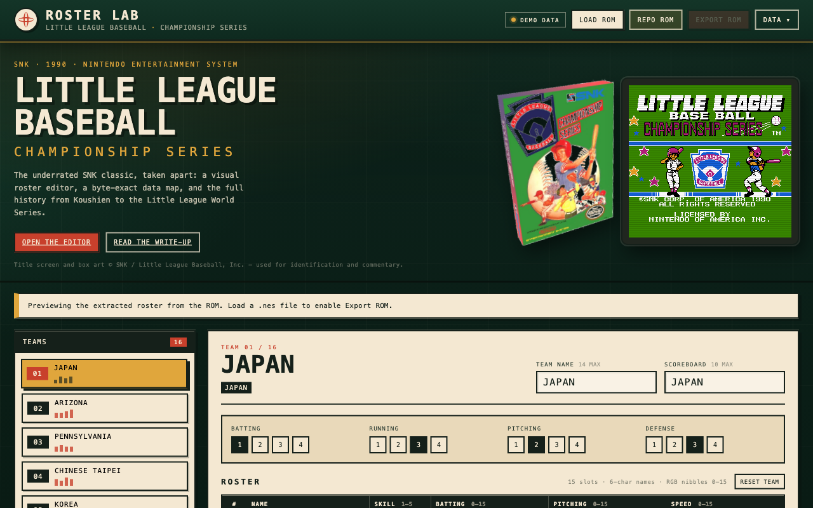

# Little League Baseball: Championship Series — ROM Lab

A preservation-minded hacking toolkit for SNK's 1990 NES baseball game: a
zero-dependency **browser roster editor**, a **byte-exact data map**, command-line
tools with a verified round trip, and a long-form **[history and technical
companion](docs/game-writeup.md)**.

<p align="center">
  
</p>

<p align="center">
  <a href="https://little-league-production.up.railway.app"><strong>Live editor</strong></a> ·
  <a href="docs/game-writeup.md"><strong>Read the write-up</strong></a> ·
  <a href="docs/roster-format.md"><strong>Roster format</strong></a> ·
  <a href="TODO.md"><strong>Living TODO</strong></a> ·
  <a href="docs/rom-layout.md"><strong>ROM layout</strong></a>
</p>

---

## The game

*Little League Baseball: Championship Series* is SNK's 1990 NES localization of
**Koushien** (甲子園), a 1989 Famicom game about Japan's national high-school
tournament. SNK rebuilt the graphics, cutscenes, menus, bracket and endings around
the Little League World Series, kept the **Baseball Stars**-derived engine, and
shipped one of the faster, stranger baseball games on the system.

Sixteen teams. Six innings. Ten-run mercy rule. No lead-offs, but you can pull a
player and put him back in. Three pitcher types per team, fifteen-player rosters,
a 1–5 skill rating on every card, and four hand-authored power-analysis bars per
team. It is not a simulation — there are no stat lines, no season mode, no team
creation — but the moment-to-moment baseball is quick, expressive and unusually
physical: dives, jumps, bunts, squeeze plays, hat-flying fastballs and batters who
throw tantrums.

The full story — Koshien, the localization, the unused Dugout mascot, the Osaka
in-joke hidden in Japan's roster, the data tables and the small hacking scene —
is in **[docs/game-writeup.md](docs/game-writeup.md)**.

---

## What's here

| | |
|---|---|
| **Browser editor** | Edit all 16 teams, names, ratings, skill and stats; export a patched ROM or JSON. No build step, no dependencies. |
| **CLI roster tool** | `tools/roster.py` — `show`, `extract`, `apply`, `patch`; extract → apply is byte-identical on an untouched ROM. |
| **Data map** | Every roster, lineup, pitcher, name, flag and rating table, with CPU and file offsets. |
| **ROM analysis** | `tools/rominfo.py` (banks, CRCs, vectors, strings) and `tools/trace.py` (6502 trace from RESET). |
| **History** | A sourced, long-form write-up of the game, its Japanese origin and its technical structure. |
| **Hosting** | Dockerfile + `railway.json`; the editor runs as a small Python server on Railway. |

---

## Browser editor

**Hosted:** <https://little-league-production.up.railway.app> — load your own ROM in
the browser; the hosted copy does not serve one.

```sh
python3 tools/serve.py
# http://127.0.0.1:8080
```

Drop a `.nes` file anywhere on the page, or put your dump in the repo root and
click **Repo ROM**. Pick a team, edit, then **Export ROM** to download a patched
copy. **Data → Export JSON** saves a roster you can re-import later.

- **Team** — 14-char display name, scoreboard name (width-limited by the ROM),
  four 1–4 power ratings.
- **Players** — 6-char name, SKILL 1–5, batting/pitching nibbles, speed.
- **Pitchers** are marked with a red `P`; their three records per team live in the
  trailer after the roster.
- **Safety** — appearance bytes are preserved, names and widths validated, and
  the leave-page guard catches unsaved edits.

The editor parses and patches the ROM **in the browser**. Nothing is uploaded.
The server only hands out `web/` (and, on loopback only, `/rom`).

Verified: `applyRom` round-trips the untouched ROM byte-identically, a browser
edit changes only the intended bytes, and the browser export matches the Node
import of `web/rom.js` byte-for-byte.

---

## CLI

```sh
# inspect the cartridge
python3 tools/rominfo.py "Little League Baseball - Championship Series (USA).nes"

# print all 16 rosters
python3 tools/roster.py show ROM

# extract to JSON, edit, rebuild
python3 tools/roster.py extract ROM -o data/roster.json
python3 tools/roster.py apply   ROM data/roster.json -o build/hack.nes

# one-off player edit
python3 tools/roster.py patch ROM --team 2 --slot 14 --name DAVE --skill 5 -o build/demo.nes

# cartridge layout / PRG expansion
python3 tools/expand_rom.py ROM --inspect
python3 tools/expand_rom.py ROM -o build/expanded.nes --prg-banks 16

# 6502 trace from RESET (needs the py65 venv)
python3 -m venv .venv && .venv/bin/pip install py65
.venv/bin/python tools/trace.py ROM 600
```

The base ROM is not included. The reference dump has MD5
`cd724fd557d323ce7fefe8a82ddf8337`; the tools check the iNES header and refuse
trainer ROMs, and the editor warns if team 1 is not `JAPAN`.

---

## ROM test harness

A browser-based jsnes harness lives at `tools/harness.html` so patches can be
boot-tested without installing an emulator:

```sh
python3 -m http.server 8097 --bind 127.0.0.1
# http://127.0.0.1:8097/tools/harness.html
# http://127.0.0.1:8097/tools/harness.html?rom=../build/16x20.nes
```

ROM-specific debugger:

```sh
# http://127.0.0.1:8097/tools/debugger.html?rom=../build/select-flags.nes
```

Shows CPU registers, named zero-page watches (`$07C0` page, `$07C1` cursor,
`$07C3` selected, `$06`, `$32`, display list), OAM, and a write log with the PC
that performed each write to the watched addresses.

Buttons and a console API (`stepFrames`, `tap`, `press`) drive the game. jsnes
uses a different NTSC palette than the console, so colours are approximate —
use it for layout, menus and crashes, not palette verification.

## Data model at a glance

| Table | File offset | Layout |
|---|---|---|
| Player records | `0x10430` | 16 teams × 15 players × 16 bytes |
| Pitcher records | team base + `$F0` | 3 × 8 bytes after a 24-byte header |
| Lineups | `0x116DA` | 16 × 9 bytes (batting order / position nibbles) |
| Team flags | `0x1176A` | 16 tile IDs |
| Team ratings | `0xF234` | 16 × 4 bars, values 1–4 |
| Team names | `0x5190` | 16 × (14 chars + `FF FF`) |
| Scoreboard names | `0x5290`, `0x52A0` | two 8-entry pointer tables |
| Team colours | `0x1FAD0`, `0x1FAE0` | 16 bytes each |

A player record is `name[6]` + ten attribute bytes. SKILL is byte 11; byte 12
selects one of the team's three pitcher records. The POWER ANALYSIS bars are
independent data, not averages of the roster — which is why Spain can have the
best raw speed value in the game and still show two bars.

The unresolved question is byte 9: the community reads it as one power byte, the
code splits it into two nibbles used separately by the batting and pitching
checks. The editor exposes the nibbles and documents the conflict in
**[docs/roster-format.md](docs/roster-format.md)**.

---

## Project layout

```
web/                  browser editor (no build step)
  index.html          layout
  styles.css          scoreboard/field styling, responsive
  rom.js              iNES parser + patcher (DOM-free, Node-testable)
  app.js              state, rendering, import/export
  roster.json         preview data
tools/
  roster.py           CLI extract/apply/patch
  expand_rom.py       PRG expansion with fixed-bank relocation
  build_16x20.py      first roster-expansion build (16 teams x 20 players)
  build_32x20.py      32-team bank-8 data + PRG-RAM cache
  pack_team_table.py  packs codes/names/regions into bank 9
  build_select_screen.py  bootable static 4x8 select screen
  extract_chr.py      every CHR tile -> per-bank PNGs, atlas, manifest
  extract_flags.py    per-team flag/label sprite blocks + sheet
  pack_flags.py       prototype: pack 24x24 flags into CHR bank 0
  build_flags32.py    generate/pack 32 flags at 24x16 into bank 10
  harness.html        jsnes browser test harness
  debugger.html       ROM debugger: regs, watches, OAM, write log
  rominfo.py          cartridge report
  trace.py            6502 trace
  serve.py            local + Railway server
docs/
  game-writeup.md     the long-form history / technical companion
  roster-format.md    data tables and field map
  rom-layout.md       cartridge, banks, MMC1, vectors
  expanding-teams-and-rosters.md
                      dependency map and phased plan for 32 teams / 20 players
  editor.png          screenshot
Dockerfile            hosting image
railway.json          Railway build/deploy config
```

---

## Hosting

The editor is a static app plus a tiny Python server, so it runs anywhere:

```sh
docker build -t little-league .
docker run --rm -p 8080:8080 little-league
```

On Railway:

```sh
railway up --service little-league
```

`railway.json` uses the Dockerfile and `/healthz`; the server binds `0.0.0.0` and
reads `$PORT`. Off loopback, `/rom` is disabled — the hosted site is a viewer and
editor for **your** ROM, not a distribution channel for the game.

### Automatic deploys

The Railway service is connected to this GitHub repository, so **every push to
`main` builds the image and deploys automatically** — no tokens or secrets
involved. Railway checks out the commit and builds the `Dockerfile`.

[`.github/workflows/deploy.yml`](.github/workflows/deploy.yml) is kept as a
manual fallback (**Run workflow** only). It needs a Railway project token and is
skipped with a warning when the secret is absent:

```sh
gh secret set RAILWAY_TOKEN --repo davefmurray/little-league
```

You can also deploy from a checkout without Actions:

```sh
railway up --service little-league
```

---

## Status

| Area | State |
|---|---|
| Cartridge / mapper / bank analysis | done |
| Roster, lineup, pitcher, flag, rating tables | done |
| Team names + scoreboard names | done |
| Player record fields | names, skill, pitcher slot confirmed; byte 9 semantics open |
| CLI editor | done, byte-identical round trip |
| Browser editor | done, tested at desktop and phone widths |
| Hosted build | Railway config ready |
| Actual custom roster | not started — that's the fun part |

Open problems worth solving next: control the pitcher record's unknown bytes,
map the palette tables, and settle byte 9 with a controlled emulator test.

---

## Legal

No ROM or game code is included in this repository. The tools operate on a ROM
you supply. The site includes the game's title-screen screenshot and box art for
identification and commentary, with credit; all rights remain with SNK and Little
League Baseball, Inc. *Little League Baseball* is a trademark of Little League
Baseball, Inc. This is an unofficial preservation and research project.

---

## Sources and credit

The write-up cites the [TecmoBowl.org hacking thread](https://tecmobowl.org/forums/topic/69604-little-league-baseball-for-nes/),
[Data Crystal](https://datacrystal.tcrf.net/wiki/Little_League_Baseball:_Championship_Series),
[The Cutting Room Floor](https://tcrf.net/Little_League_Baseball:_Championship_Series),
[Wikipedia](https://en.wikipedia.org/wiki/Little_League_Baseball:_Championship_Series),
[StrategyWiki](https://strategywiki.org/wiki/Koushien),
[LaunchBox](https://gamesdb.launchbox-app.com/games/details/8177) and the
[archived NES Archives review](https://web.archive.org/web/20080503192431/http://www.nesarchives.com/Littleleague.html).
The table addresses and team statistics were derived directly from the US ROM.
