# Expanding teams and rosters

"More teams" and "more players per team" are two different projects with very
different costs.

- **More players per team** is a data-layout change. The tables are small, the
  menus are the only real risk, and it can be done without growing the cartridge.
- **More teams** changes the tournament, the team-select screens, the password
  format and the graphics. It is a UI and game-design project, not a table edit.

This document maps every hard-coded assumption, the space budget, and a phased
way to get to **32 teams × 20 players** without a rewrite.

---

## The limits as shipped

| Limit | Value | Where it lives |
|---|---|---|
| Teams | 16 | pointer table at `$8400`, 4×4 select grid, bracket, password |
| Players per team | 15 | 15 × 16-byte records per team |
| Team block | `0x120` bytes | 15 records + 48-byte pitcher trailer |
| Pitcher records | 3 × 8 bytes | trailer at team base + `$F0` |
| Tournament | 16 teams, 4 rounds | bracket table `$8941`, slots `$0650` |
| Cartridge | MMC1, 128 KiB PRG, 128 KiB CHR | header |

Team block size for *N* players is `N * 16 + 48`:

| Players | Stride | 16-team block | 32-team block |
|---|---|---|---|
| 15 | `0x120` | `0x1200` (4,608 B) | `0x2400` (9,216 B) |
| 18 | `0x150` | `0x1500` (5,376 B) | `0x2A00` (10,752 B) |
| 20 | `0x170` | `0x1700` (5,888 B) | `0x2E00` (11,776 B) |
| 24 | `0x1B0` | `0x1B00` (6,912 B) | `0x3600` (13,824 B) |

---

## Where the 16-team assumption lives

| System | Address | What assumes 16 | Work if you expand |
|---|---|---|---|
| Roster pointer table | `$8400` | 16 words, immediately followed by team 0's data at `$8420` | 32 words need a new home; 19 code references use `$8400,X` |
| Team long names | `$9180` (bank 1) | 16 × 16 bytes, 14 chars + `FF FF` | 32 × 16 = +256 B, and any name-list code |
| Team short names | pointers `$9280`, `$9290` | two 8-entry tables | one 32-entry table, or four 8-entry tables |
| Team ratings | `$B224` (bank 3) | 16 × 4 bytes | 128 B; the power-analysis routine at `$AFD4` indexes `team*4+3` |
| Team flags | `$975A` (bank 4) | 16 tile IDs | 32 IDs + 16 new flag tiles |
| Team colours | `$FAC0` (fixed bank) | 16 three-byte records (cap and trim, jersey, hair), read through `$C6FE` | 32 × 3 = 96 B and a routine that indexes 32 teams; see [Roster Lab team colors](editor32.md#team-colors) |
| Lineups | `$96CA` (bank 4) | 16 × 9 bytes | 32 × 9 = 288 B; `$AD44` computes `team*9` |
| Team select grid | `$CB52` (bank 7) | 4 rows × 4 teams, flags drawn from `$975A,X` | 8×4 paged grid or a scrollable list; new cursor/selection code |
| Team list bound | `$96CD` (bank 1) | `LDA #$0F; STA $CE` — max index 15 | set to `teams-1`; also check `$9BB3` (`LDA #$0F; STA $B1`) |
| Tournament bracket | `$8941` (bank 5) | 3-byte records per round: two team slots + next slot | regenerate for 5 rounds; new bracket screen layout |
| Bracket storage | `$0650` (RAM) | 16 first-round slots plus winners | 32 slots + 16 winners, and the round counter `$0746` |
| Password | `$A036` (bank 5) | 12 state bytes `$074B–$0756` + round `$0746` packed into chars | new encoding for more teams/rounds; verify checksum |
| CHR flags | CHR banks | flag tiles already in the 128 KiB CHR | 16 more flags must fit existing CHR (MMC1 cap) |

The 4×4 grid at `$CB52` is the clearest hard stop: it draws four rows of four
teams, 12 sprites wide, with no paging. A 32-team game needs a different screen,
not a bigger table.

---

## Where the 15-player assumption lives

| System | Address | What assumes 15 | Work |
|---|---|---|---|
| Player records | team base + 0..`$E0` | 15 × 16 bytes | add records; stride grows |
| Pitcher trailer | team base + `$F0` | FF row, then 3 pitcher records | moves to `N*16` |
| Trailer lookup | bank 4 `$B094` | computes `base + $100 + byte12` | must become `base + N*16 + $10 + byte12`; needs a trampoline, not a one-byte patch |
| Lineup | 9 players | fixed by baseball | unchanged |
| Player-change menu | unknown | likely draws 15 names / 3 rows of 5 | **discovery task**: find the list bound and grid height, patch to *N* |
| Pitcher RAM | `$04EE`, `$04F9–$04FE`, `$06E2` | away/home index + pitcher slot/stamina | see `docs/ram-map.md` |

The one code change that is definitely required is the trailer math. The current
routine is:

```
$B094  LDX $04EE
$B097  LDA $04FD,X
$B09A  ASL A ×4          ; player index × 16
$B09E  JSR $B07C         ; $04 = team_base + player*16
$B0A1  CLC
$B0A2  LDY #$0C
$B0A4  LDA ($04),Y       ; byte 12: 08/10/18
$B0A6  ADC $8400,X       ; + team base low
$B0A9  STA $04
$B0AB  LDA $8401,X
$B0AE  ADC #$01          ; + $100
$B0B0  STA $05
$B0B2  RTS
```

For 20 players the trailer's first pitcher line is at `base + $150`, so the
routine must add `$150` instead of `$100`. There is no room in place for two more
bytes, so replace `$B094` with `JMP` to a relocated copy in free space that does:

```
LDA ($04),Y
ADC $8400,X
ADC #$50        ; extra $50 on top of the $100
STA $04
LDA $8401,X
ADC #$01        ; carry from the $50 propagates
STA $05
RTS
```

Every caller keeps calling `$B094`; only the destination moves.

---

## Space budget

### Inside the existing 128 KiB

Bank 4 free runs (all `$FF`):

| Range | Size |
|---|---|
| `$985A–$AA40` | 4,518 B |
| `$B6F7–$C000` | 2,313 B |

The original roster block (`$8420–$9620`) becomes free once rosters move, but it
is **not contiguous** with the free runs — lineups, flags and a large table at
`$976A–$985A` sit in between. That table is used, so it cannot be overwritten.

**16 × 20 fits in the free runs if teams are allowed to be non-contiguous:**

- teams 0–11 at `$985A + team * $170` (last block ends `$A9AA`, inside the run)
- teams 12–15 at `$B6F7 + (team-12) * $170` (last block ends `$BCB7`)
- the pointer table at `$8400` simply points at each block, so no relocation of
  lineups, flags or the `$976A` table is needed.

**32 × 20 does not fit** (`0x2E00` = 11,776 B vs 6,831 B free), even after
reclaiming the old roster block (11,439 B total — still short).

### Cartridge limits

| | MMC1 limit | This ROM |
|---|---|---|
| PRG | 32 × 16 KiB = **512 KiB** | 128 KiB (8 banks) |
| CHR | 32 × 4 KiB = **128 KiB** | 128 KiB — **already maxed** |

So PRG can grow to 256 or 512 KiB; CHR cannot grow at all. New team flags must
fit into the existing 128 KiB CHR (several banks are sparse: bank 18 is 82%
empty, bank 25 70%, bank 24 62%).

MMC1 fixes the **last** PRG bank at `$C000`. Growing from 8 to 16 banks moves the
fixed bank from 7 to 15, so the original bank 7 must be copied to bank 15 or the
reset vector disappears.

`tools/expand_rom.py` does exactly that and verifies the result:

```
$ python3 tools/expand_rom.py ROM -o build/expanded.nes --prg-banks 16
  size        393,232 bytes
  PRG         16 banks (256 KiB)
  CHR         16 banks (128 KiB, unchanged)
  fixed bank  15 (copy of original bank 7)
  vectors     $CD85/$CBD5/$CDF4
  free banks  8-14 (7 banks, 112 KiB)
```

---

### 512 KiB is not possible with 128 KiB CHR on MMC1

The 512 KiB build boots in jsnes, but it is **not a valid MMC1 cartridge**.

Per the [NESdev MMC1 specification](https://www.nesdev.org/wiki/MMC1), the CHR
bank register's bit 4 is **CHR A16 when CHR is 128 KiB**, and the same line is
**PRG A18 when PRG is 512 KiB**. They are mutually exclusive. Every 512 KiB
SxROM board (SUROM, SXROM) addresses only **8 KiB of CHR RAM**, not 128 KiB CHR
ROM.

So:

- **256 KiB PRG + 128 KiB CHR** is the MMC1 maximum for this game. That is the
  current build (banks 8–15 switchable, 112 KiB free).
- **512 KiB PRG + 128 KiB CHR** requires a different mapper. MMC3 (mapper 4)
  supports 512 KiB PRG and up to 256 KiB CHR, but converting means replacing the
  MMC1 serial bank routine, the CHR bank routines, mirroring and PRG-RAM setup —
  a mapper port, not a header edit.

The 512 KiB `.nes` is kept only as an emulator experiment; do not treat it as
hardware-valid. The practical path is to finish the 32-team UI on the 256 KiB
build, and only port to MMC3 if the 112 KiB of free PRG actually runs out.

### Team select: 4 pages × 8

The 32-team selector uses four pages of eight teams (2 rows × 4 columns). Full
team names do not fit a 56-pixel cell at the 8×8 font — the ROM's "short name"
tables are actually full names with a leading attribute byte — so cells show a
three-letter code and the detail bar shows the full name, record, skill and
region.

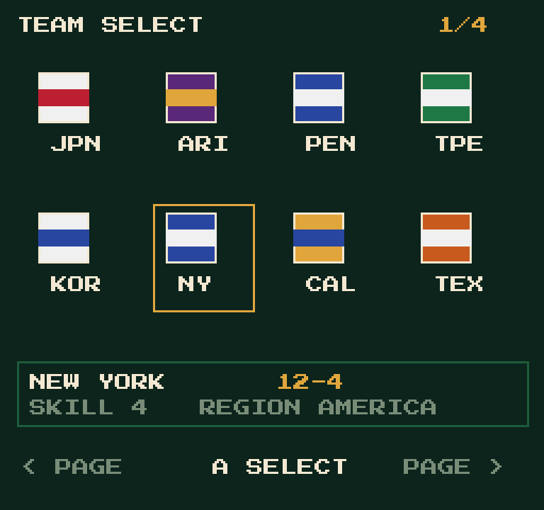

Page 1 covers teams 0–7, page 2 8–15, page 3 16–23, page 4 24–31. Left/Right at
the grid edge flips page; per-page cursor memory; A selects.

The metadata is packed into **bank 9** at `$8000`:

| Range | Contents |
|---|---|
| `$8000–$807F` | 32 × 4-byte codes (3 chars + NUL) |
| `$8080–$827F` | 32 × 16-byte names (14 chars + `FF FF`) |
| `$8280–$829F` | 32 × 1-byte region (0 ASIA, 1 AMERICA, 2 EUROPE, 3 HAWAII, 4 NEW) |

`tools/pack_team_table.py` writes it; the 32-team ROM boots with the cache and
table intact. Screen state is planned at `$07C0` page, `$07C1` cursor,
`$07C2–$07C5` per-page cursor memory.

### Display-list renderer

The game draws screens through a display list in RAM:

| Address | Use |
|---|---|
| `$0300` | display-list buffer |
| `$32` | list length (bytes used) |
| `$C53A` | flush list to PPU (`LDX #0`, then `$C53C`) |
| `$C76D` | append a run: PPU address in `$06B3/$06B4`, data at `$06B5` terminated `$FE` |
| `$C790` | append an RLE run (high byte `| $40`, low, count, tile) |

Run format: `[PPU high, PPU low, tile…, $FE]`, repeated; `$32` is the end index.
With `$C040` bit 6 set, the high byte is `address | $40` and the run becomes
`[high, low, count, tile]` (fill).

So the 2×4 screen becomes: build header/cells/detail runs into `$0300`, set
`$32`, `JSR $C53A`, then enable rendering.

### Font

The font is **CHR bank 0**, tiles `$20–$5F` in ASCII order: space and
punctuation, `0–9`, then `A–Z`. Text strings are copied verbatim into `$06B5`
and straight into the display list — there is no ASCII conversion.

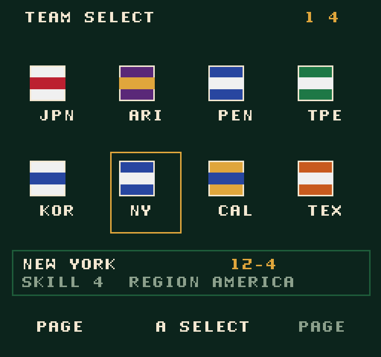

Caveat: `<`, `>` and `/` do not sit at their ASCII tiles in this font. Use words
(`PREV` / `NEXT`) or custom arrow tiles instead of punctuation arrows.

### First in-ROM screen

`tools/build_select_screen.py` rebuilds the ROM so the MMC1-init hook jumps to a
screen routine instead of the game. It sets up the PPU, loads the palette,
clears the nametable, copies a prebuilt display list to `$0300`, flushes it with
`$C53A`, enables rendering and loops. Page 1 is built from the bank-9 codes.

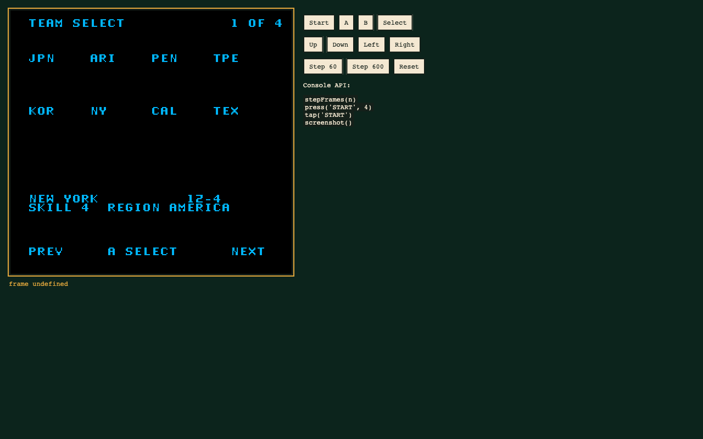

The static screen proves the full pipeline: bank-9 table → display list → font
tiles → PPU.

### Four-page input

Four page lists live at `$FB83` (160-byte blocks, length byte first); the screen
code at `$FE30` reads the controller, maps Left/Right to page ±1 mod 4, and
re-flushes the list. The pointer table is at `$FFE0`.

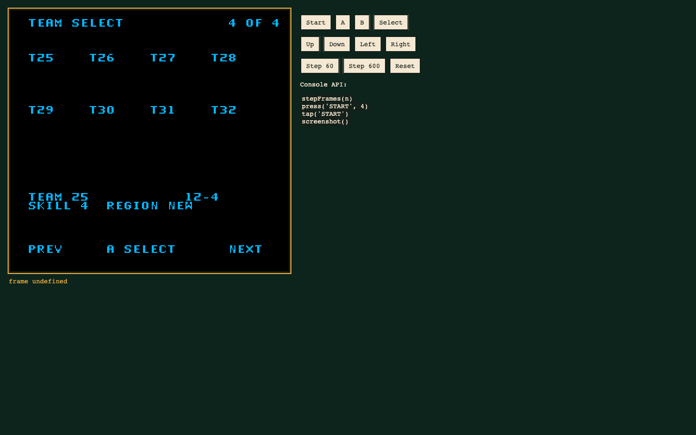

Left/Right wraps 1 → 4 and back; each page shows its own eight codes and detail
bar.

Cursor state is `$07C1` (0–7), page `$07C0`. Up/Down moves between the two rows,
Left/Right moves within a row and flips page at the edge. The selected cell gets
a `-` marker from a per-cursor address table; the page list writes a leading
space at each marker position so the previous marker is cleared on redraw.

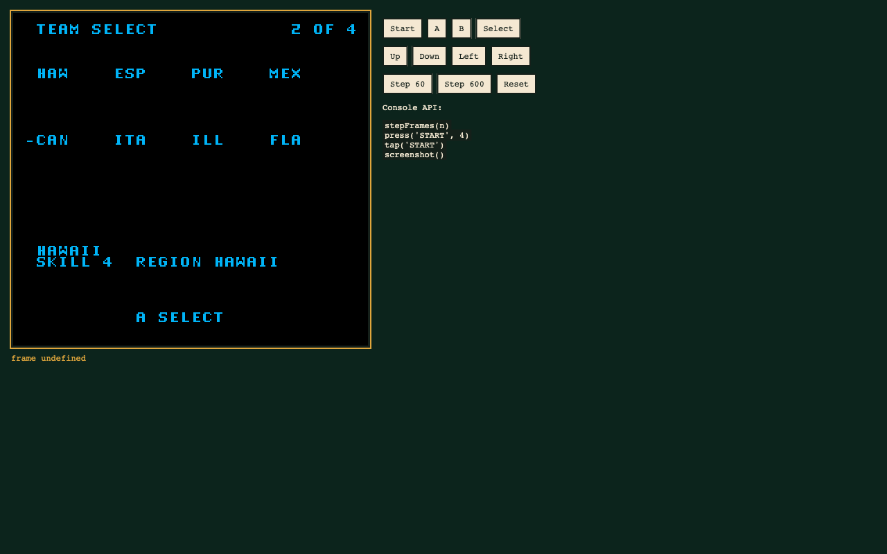

The detail name is now appended per draw from the bank-9 name table, so it
follows the cursor. A stores the selected team (`page * 8 + cursor`) at `$07C3`.


Verified: cursor 1 shows ARIZONA, and A writes team `1` to `$07C3`.

### Flag format

Flags are **sprites**, not background tiles:

- `$975A` holds 16 byte offsets (0, `$48`, `$18`, …) into the sprite table.
- `$976A` holds 24 bytes per team: 12 × `(tile, attribute)` pairs.
- The draw loop at `$CB52` writes 3 sprites per row, 4 rows (24×32 px), incrementing
  Y by 2 per sprite and the OAM pointer by 4.
- Attribute bytes carry palette/flip; tile IDs are sprite-page indices.

Team 0 (JAPAN) uses tiles `0,1,0 / 2,3,4 / 56,57,56 / 202,208,206`.

The bank numbers come from a 6-byte-per-team table at **`$FB4E`**:

| Team | bytes (CHR0a, CHR0b, CHR1a, CHR1b, ptr lo, ptr hi) |
|---|---|
| JAPAN | `1B 1B 18 1C 50 06` |
| ARIZONA | `18 05 05 18 70 06` |
| NEW YORK | `19 1E 19 1E 38 06` |
| CALIFORNIA | `15 12 12 12 68 06` |

`$C6C1` turns the team index into a 6-byte stride, stores the first four bytes in
`$23–$26`, and `$CE36/$CE4B` write them to CHR0; `$CE40/$CE50` write the other
pair to CHR1. Palette setup copies 16 bytes per block to `$0195` via `$C1C0`.

Rendering the 24-byte blocks out of those exact 4 KiB banks shows label/flag-card
art (`JPN`, `AZ`, `NY` glyphs plus the flag field), confirming the table but not
a standalone flag bitmap. The blocks need their attribute palettes applied to
separate flag from label.

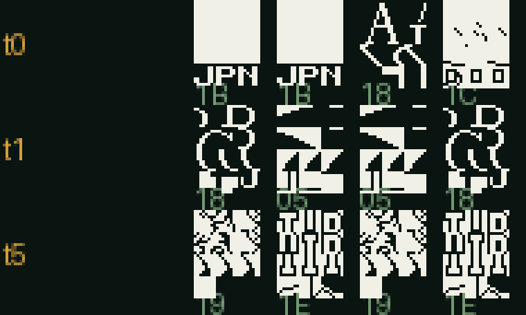

### CHR inventory

`tools/extract_chr.py` dumps all **131,072 bytes / 32 × 4 KiB banks** as
per-bank PNGs plus `chr-atlas.png` and `chr.json` (empty/duplicate/unique counts
per bank).

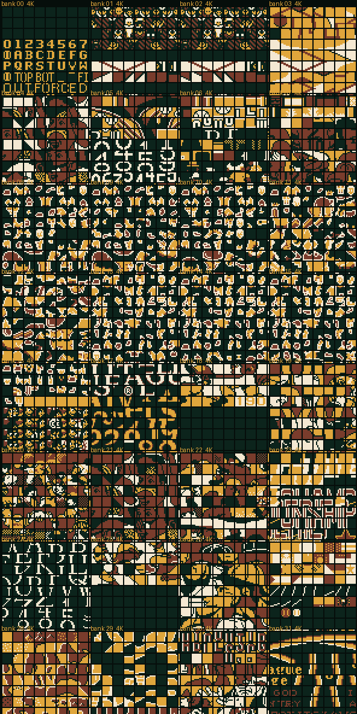

Inventory: **940 empty** tiles and **1,689 duplicates**. The sparsest banks are
18 (189 empty), 25 (156), 29 (135), 27 (91), 0 (71). That is where spare tiles
for copied flag art will come from.

### Flag extraction

`tools/extract_flags.py` renders every team's 24×32 sprite block using the
per-team CHR bank from `$FB4E`, the tile/attribute pairs from `$976A`, and the
attribute palette/flip bits.

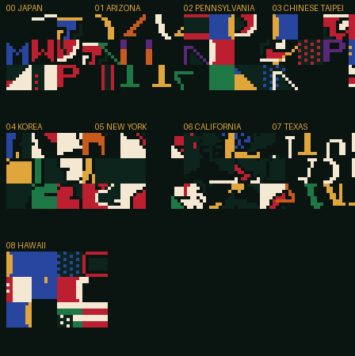

Two limits surfaced:

- Only teams 0–8 have per-team CHR entries; 9–15 are `FF` and need their shared
  bank resolved.
- The draw loop is **4 columns × 3 rows** (X advances inside the inner loop),
  not 3 × 4; the extractor now uses that order.
- The blocks contain both flag art and team-label glyphs, so they are extracted
  assets rather than separated flag bitmaps yet.
- 16×16 downscales are emitted (`16-XX-*.png`) to fit the CHR spare-tile budget,
  but at that size the label glyphs dominate; they are not shippable as flags.

### OAM ground truth (flags)

Capturing live OAM on the team-select map gave the definitive flag format:

- **9 sprites, 3 × 3** (24 × 24 px)
- tiles `$05,$06,$07 / $08,$09,$07 / $0A,$0A,$0A`
- attribute `$02`, sprite pattern table `$0000`
- CHR bank `$1B`, palette 2 = `0F,16,30,28`

Rendering exactly those tiles and that palette produces a clean **US flag**:

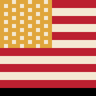

The `$976A` records are region/team **cards**, not 32 unique team flags; the
first nine tiles of entry 1 coincidentally match the US flag, but applying the
table attributes does not reproduce it. The game therefore supplies **region
flags** (US, Japan, …), not a unique flag per team.

For 32 team cells there are two honest options:

Sprite budget comparison (live OAM):

| Object | OAM entries | Mode | Pixels |
|---|---|---|---|
| Player | 2 × 5 = 10 | 8×16 | 32 × 80 |
| Flag | 3 × 3 = 9 | 8×8 | 24 × 24 |

Eight flags = 72 sprites, over the 64-sprite OAM limit; that is why the grid
needs flags as background/CHR tiles rather than sprites.

1. Reuse region flags in the grid (fast, but duplicate flags).
2. Generate 32 new 24×24 flag tiles and copy them into spare CHR bank 0 space.

### Next five landmarks

The selector code is now 557 bytes at `$FD90`, ending at `$FFC5`; the marker and
page tables sit at `$FFD0–$FFE7`, so the fixed bank has only a few bytes left.
The next five steps start with a relocation:

1. **Move the selector to bank 10.** Code, lists, palette, codes, names and
   regions all live in one free 16 KiB bank at `$8000`, with a tiny fixed-bank
   trampoline (`LDA #10; JSR $C14E; JMP $8000`). No mid-code bank switching.
2. **Flags in the cells.** Extract the flag tile blocks/colours and place them
   above each code; verify CHR space in the 128 KiB limit.
3. **Selection feedback.** Persistent selected marker plus a `SELECTED` line;
   B clears the pick.
4. **Wire into the tournament.** Replace the 16-team list/map path with the
   selector, pass `$07C3` into the existing bracket setup.
5. **32-slot bracket + password.** Five rounds, 32-slot state, new password
   encoding.

The relocation is the gate: it frees the fixed bank and gives the selector room
for flags, feedback and the bracket handoff without byte golf.

### Bank-10 relocation (done)

The selector now lives entirely in **bank 10**:

| Range | Contents |
|---|---|
| `$8000` | code (541 bytes) |
| `$9000` | four page lists, 160-byte blocks |
| `$9300` | palette |
| `$9320` | marker address table |
| `$9330` | page pointer table |
| `$9400` | 32 × 16-byte names |

The fixed bank keeps a trampoline at `$FF00`: `LDA #10 / JSR $C14E / JMP $8000`.
Because the names are local to bank 10, the code never switches banks mid-run.


Cursor, edge-paging, dynamic detail and A-selection all work from bank 10, and
roughly 4 KiB before `$9000` is free for flags and selection feedback.

Selection state is `$07C3` (`$FF` = none). A stores the current team and
redraws; B clears it and redraws. The draw appends `OK` at `$2362` when the
cursor is on the selected team, and refreshes the list index after the name run
so the marker never overwrites it.

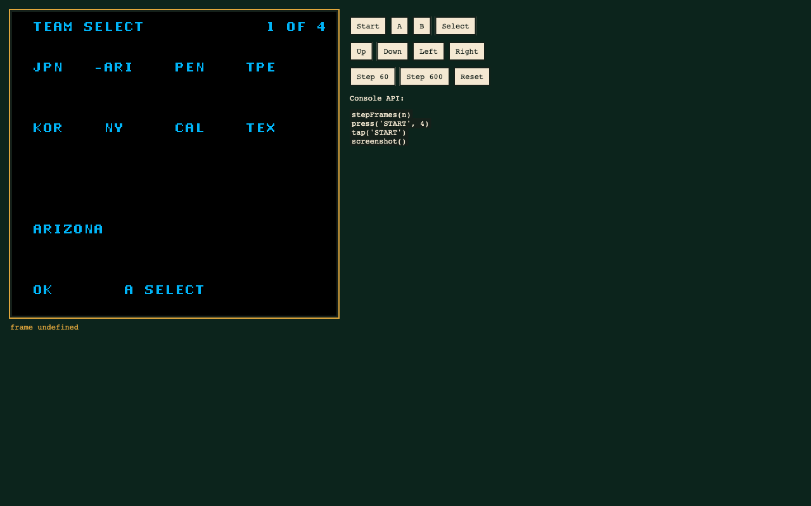

## Progress log

- `tools/expand_rom.py` — done and verified: 16 PRG banks, fixed bank 15, banks
  8–14 free, banks 0–7 and CHR byte-identical.
- `tools/harness.html` — done: jsnes boots the stock ROM and patched builds in
  the browser; buttons plus `stepFrames` / `tap` console API.
- `tools/build_16x20.py` — done: 16 teams × 20 players, split across the two free
  runs, pointer table rewritten, trailer lookup relocated.
- 16 × 20 build tested: boots, title, menu, team select, pre-game lineup screen;
  all nine starter names load from the relocated records.
- Still to verify on 16 × 20: pitching from each of the three slots, the bench /
  pinch-hitter list (its bound is the remaining unknown), and a full game.
- 32-team build not started: needs the bank-8 migration, team-select paging,
  32-slot bracket and password work.

## Recommended path

### Milestone 0 — cartridge expansion (ready)

Use `tools/expand_rom.py` to make a 256 KiB PRG build. It is byte-identical to
the original in banks 0–7, so the unmodified game still runs; it just has 112 KiB
of new bank space and a relocated fixed bank. Boot-test in an emulator before
building on it.

### Milestone 1 — 16 teams × 20 players, in place

No cartridge expansion needed. This validates the trailer patch and the menus
before adding teams.

1. Build the new rosters in the two free runs (12 + 4 teams).
2. Rewrite the 16 pointers at `$8400` to the new bases.
3. Replace `$B094` with a `JMP` to the relocated trailer routine.
4. Find and patch the player-change list bound (15 → 20) and its grid height.
5. Update the editor/JSON layout to 20 players.
6. Test: pitching with each of the three slots, substitutions, player cards,
   pinch hitter/runner, lineup screen, full game.

Risk: the player-change menu is the only unknown. Everything else is table
plumbing.

### Bank-8 blocker (discovered while planning 32 × 20)

Moving the rosters to bank 8 is not a table move. Three roster readers live in
**bank 4 itself**:

| routine | what it does |
|---|---|
| `$AB2D` | reads the pointer table at `$8400,X` to set up the active players |
| `$B086` | computes the player pointer for the card/stat path |
| `$B0A7` | reads the pointer high byte for the same path |

Code running in bank 4 cannot switch to bank 8 and keep executing: the next
instruction fetch would come from the wrong bank. So a 32-team bank-8 layout
requires one of:

1. relocating those routines to the **fixed bank** (`$C000`, 1,133 free bytes at
   `$BB83`) and calling them there,
2. a fixed-bank trampoline that switches to bank 8, performs the record read,
   and switches back, or
3. copying the active teams' records into RAM at game start (only the active
   roster fits, not all 32).

Option 1 is the cleanest **if** the readers must move. But there is a better
route: **copy-on-select**.

### Chosen: copy-on-select through PRG RAM

PRG ROM cannot be written at runtime, so the cache must live in RAM. The cart has
8 KiB of PRG RAM at `$6000`.

1. At boot, a fixed-bank routine copies the roster pointer table `$8400–$841F`
   to **PRG RAM `$7000`**.
2. Every real table read is repointed from `$84xx` to `$70xx`. There are exactly
   **10** such instructions: `$B085`, `$B08C`, `$B0A6`, `$B0AB`, `$AB2C`,
   `$AB33`, `$8432`, `$8439` (bank 4) and `$CB2C`, `$CB36` (fixed bank).
3. When teams are selected, a fixed-bank routine switches to bank 8, copies their
   `0x170` blocks into PRG RAM (`$6000`, `$6170`, …), and writes their addresses
   into the RAM table.
4. The engine reads the RAM table and dereferences into PRG RAM. No reader
   relocation, no ROM writes.

**Proven in emulator:** two teams in bank 8 were renamed `ZZA01…` / `ZZB01…`,
copied at boot to `$6000` / `$6170`, the RAM table entries set to `$6000` /
`$6170`, and the pre-game lineup screen rendered `ZZA01`–`ZZA09` for New York.

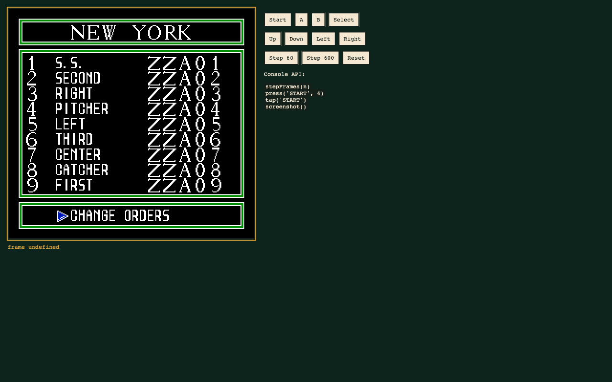

`tools/build_copy_on_select.py` builds the two-team proof ROM.

`tools/build_32x20.py` now fills bank 8 with **all 32 teams** (20 players each)
and bulk-caches the 16 active teams at boot (`$6000–$76FF`, table `$7F00`). The
16-team UI boots and the lineup renders normally from the cache. The remaining
work is the UI/bracket layer: on-demand copies for teams 16–31, a 32-team select
screen, a 5-round bracket and the password format.

### Milestone 2 — 32 teams × 20 players

1. Build the 256 KiB PRG image with `expand_rom.py`.
2. Put the new roster block in **bank 8**: 32 × `0x170` = `0x2E00`, plus the
   64-byte pointer table. Bank 8 is `$8000–$BFFF` when selected; the block fits
   with about 4 KiB to spare.
3. Move the team tables to bank 8/9: names 512 B, short names ~700 B, lineups
   288 B, flags 32 B, colours 64 B, ratings 128 B.
4. Patch the 29 `LDA #$04; JSR $C14E` sites. Only the ones that read roster or
   team tables become `LDA #$08`; the rest stay on bank 4 for its code/data.
5. Patch the 19 references to `$8400` to the new table address.
6. Rebuild the team-select screen, team list, bracket and password.

### Milestone 3 — tournament and presentation

- 5-round bracket (32 → 16 → 8 → 4 → 2 → 1), new bracket table and screen.
- Password encoding for 32 teams and 5 rounds.
- 16 new flag tiles from spare CHR space, plus colour entries.
- Team-select paging (8×4 with two pages, or a 6×5 grid plus overflow).

---

## Tooling setup

The tools currently hard-code 16 teams, 15 players, `$8400`, `0x120` and the
table addresses. Before building a variant, introduce a layout manifest that both
`tools/roster.py` and `web/rom.js` read:

```json
{
  "name": "32x20",
  "prg_banks": 16,
  "teams": 32,
  "players": 20,
  "roster_table": "0x8000",
  "roster_table_bank": 8,
  "team_stride": "0x170",
  "trailer_offset": "0x150",
  "lineups": "0x9000",
  "flags": "0x9120",
  "ratings": "0x9140",
  "names": "0x9200",
  "short_names": "0x9400"
}
```

Then:

- `roster.py show/extract/apply/patch` take `--layout layout.json`.
- `web/rom.js` loads the same JSON and renders N teams × M players.
- The editor gains a variant selector; export validates against the layout.
- A patch script per milestone turns the base ROM into the variant, so the
  transformation is reproducible instead of a hand-edited binary.

Suggested branches:

```
main                 stock 16x15 tooling
hack/16x20           in-place roster expansion
hack/32x20           expanded cartridge + new UI
```

## Test plan

There is no emulator installed on this machine yet. Before milestone 1, install
one with save states and a tile/RAM viewer (Mesen2 or FCEUX). Minimum checks:

1. Boot to title, start a game, pitch with each of the three pitcher slots.
2. Open the player-change screen and confirm all 20 names are reachable.
3. Pinch hit/run from the new bench slots.
4. Player card for a new slot shows the right name/skill.
5. Save/password round-trip.
6. 32-team build: team select, bracket, all five rounds, password.

---

## What I need from you

1. **Target roster size** — 18, 20 or 24 players per team? 20 is the sweet spot
   for a 4×5 menu grid and fits the free space comfortably.
2. **Target team count** — 24 or 32? 32 is cleaner for the bracket (five full
   rounds, no byes); 24 needs byes and a more awkward bracket.
3. **Tournament** — must single-player expand to the new team count, or are the
   extra teams exhibition-only?
4. **Hardware** — emulator/flash cart only, or does this need to run on a real
   MMC1 donor board? (PRG expansion to 256 KiB is fine on SxROM boards and flash
   carts; CHR cannot grow.)

My recommendation: **16 × 20 first**, then **32 × 20** on the expanded cartridge.
It gets a playable result quickly, proves the trailer and menu patches, and
leaves the bracket/password work for a focused second phase.
