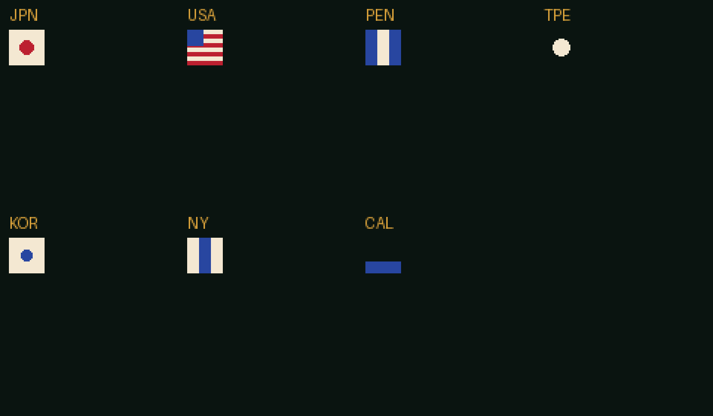

# Flags in CHR — working notes

Status: **prototype**. 7 flags are packed into CHR bank 0's empty tiles and
render from the packed ROM. The 8th flag does not fit the empty-tile budget.

## The numbers

| Fact | Value |
|---|---|
| Flag size | 24 × 24 px |
| Background tiles per flag | 3 × 3 = **9** |
| OAM sprites per flag | **9** (3×3), palette 2, CHR `$1B` |
| OAM budget for 8 flags | 72 > 64 — cannot be sprites |
| CHR bank 0 empty tiles | **71** |
| 8 flags needed | **72** |
| Prototype packed | **7 flags / 63 tiles** |

24×24 is **pixels**, not tiles. One flag = nine 8×8 tiles.

## Why background tiles

A page of eight flags is 72 sprites, over the 64-sprite OAM limit. As background
it is 72 tiles, and CHR bank 0 has 71 empty tiles — one short. Options:

1. Pack **7 flags per page** (prototype does this).
2. Overwrite one duplicate tile or a known-unused glyph to reach 72.
3. Make flags **3×2 tiles** (24×16) = 6 tiles; 8 flags = 48.
4. Pack flags into bank 18/25 and swap CHR for the flag area (complex).

## Prototype

```
.venv/bin/python tools/pack_flags.py build/32x20-ui.nes -o build/flags-chr.nes
```

- Finds all-empty tiles in CHR bank 0 (`16 × $00`).
- Generates seven 24×24 designs: JPN, USA, PEN, TPE, KOR, NY, CAL.
- Quantizes to a shared 4-colour set: `0` bg, `1` white, `2` red, `3` blue.
- Writes 9 tiles per flag into the empty slots.
- `build/flags-chr.json` maps each flag to its **nine tile indices**.

Important: empty tiles are **scattered**, not contiguous. A flag is not
`base .. base+8`; it is the nine indices in the JSON list.



Known art issues in the prototype: TPE's green background and CAL's gold map to
index 0/3 with this palette, so those flags lose their field colours. Real
extracted flags or a per-page palette will fix that.

## Draw plan (selector)

For a cell at nametable row `r`, column `c`:

- For `ty` 0..2, `tx` 0..2:
  - tile = `flag.tiles[ty*3 + tx]`
  - PPU address = `$2000 + (r+ty)*32 + (c+tx)`
  - write tile via the display list.
- Attribute byte for the cell selects the palette; flags share one palette in the
  prototype.

The draw routine already builds `$0300` runs; a flag run is nine 1-tile runs (or
three 3-tile runs per row).

## Runtime CHR copy (next step)

Because only one page is visible, copy that page's eight flags into the same 72
tile slots at page change:

1. Disable rendering.
2. For each of 8 teams × 9 tiles, write pattern data to PPU `$0000` using
   `$2006 = tile*16 >> 8`, `$2006 = (tile*16) & $FF`, then 16 bytes to `$2007`.
3. Re-enable rendering.

Source data can live in bank 10 (selector bank) as 8×9×16 = 1,152 bytes per page;
all four pages = 4,608 bytes. Bank 10 has room.

## Pitfalls

- **Do not assume contiguous tiles.** Use the mapping list.
- **Colour 0 is the background**, so a flag's field must use palette index 1–3,
  not 0, or it disappears.
- **Attribute granularity is 16×16 (or 32×32)**: per-cell palettes need the
  attribute table updated alongside tiles.
- **CHR bank 0 is the font bank**; never overwrite `$20–$5F` (space..Z).
- **The 8th flag overflows 71 empty tiles**; resolve before shipping a full page.

## Next

1. Replace generated designs with the real extracted flag art (or curated
   designs) using the 4-colour set.
2. Decide the 8th-tile solution.
3. Add page-time CHR copy and a per-flag tile table to bank 10.
4. Draw flags above the codes; update attributes.
5. Verify in the harness page by page.
