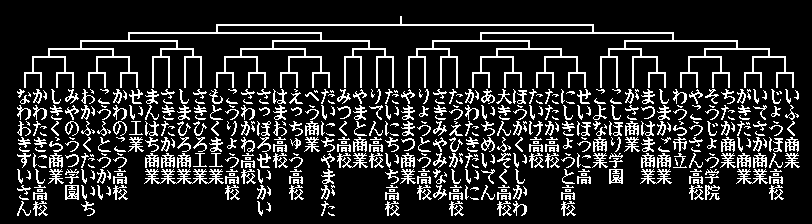

# Koushien (Japan) bracket — 32-team reference

Source: `Koushien (Japan).nes` from the MacBook Air
(`/Users/dfm/Downloads/little league japanese/`).

- Size: 262,160 bytes
- Header: 8 PRG / 16 CHR, mapper 1 (MMC1)
- MD5: `3fb53057faeb5f4e9fab6a8c9494296c`

## What the bracket shows

The Japanese bracket is **32 teams / five rounds**:

- four columns of eight names,
- 16 first-round matches,
- then 8, 4, 2, 1.

The US release is **16 teams / four rounds** (8, 4, 2, 1).

## Does the ROM port?

No — it is a different data layout:

- No ASCII team names at the US offsets.
- US roster/lineup/colour offsets land on unrelated bytes.
- Same 256 KiB MMC1 shell, so the *screen and bracket structure* transfer as a
  design, not the data.

## Use for our 32-team build

- Slot layout: 32 leaves, 16/8/4/2/1.
- Column density: eight names per column with three-line labels fits a 256×240
  screen when the bracket is drawn as four columns.
- Round labels and connector style can be reused.

## Next

- Locate the Japanese bracket table (team-index array) and extract the slot
  ordering.
- Compare its screen tilemap with our bank-10 display-list layout.
