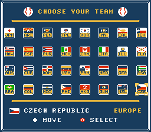
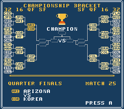

# Selector and bracket art with menu music

`menuart32.nes` replaces the two custom menus with NES tile artwork and
the game's existing menu song. It builds on `visualtables32.nes` (`cf4f1126`)
and produces SHA-256
`bcb7fcdc2c1decd47de2f3504c8c81d907a3d195629a1526ff4b0e919a89f2a3`.
The candidate changes 9,115 bytes. CPU, controller, audio-activity and
stock-six/full-31 tournament checks pass.




These are emulator captures. The selector presents all 32 teams in an
8-by-4 grid, with a flag, code, full name and region. The bracket draws
all 63 valid slots as a tree, highlights the next match and shows its two
full names. Future winners stay blank even when RAM contains stale data.
The seeded order, ownership mask, password format and result logic are
unchanged. LIST is a view; CONTINUE and password restore show the next
match. A finished tournament returns to the title safely.

The music is stock song `$06`, also used by the original mode menu.
Move and confirm use stock effects `$36` and `$35`. Entering a menu only
queues the song when it is not already playing. Returning after a game
replaces the result jingle once. The stock selector-to-bracket handoff
has one frame without an audio tick.

## Art and build

[claude-pxl](https://github.com/augusto-scarvalho/claude-pxl) renders
[`art/menu32/menu32.px.js`](../art/menu32/menu32.px.js) into the committed
PNG inputs. `PXL.json` pins commit
`3bc816cb15a14592e0dc062ee98013637d399457` and Node 22.18 or newer.
The converter enforces NES colors, transparency, 16-by-16 attribute-cell
palettes and the tile budget. The art uses 221 of 256 tiles, including
37 stock font glyphs copied from the input ROM at build time. Those
glyph patterns are not stored in the asset JSON.

The regular pipeline uses committed assets and does not need Node or pxl:

```sh
.venv/bin/python tools/build_32team_full.py
.venv/bin/python tools/test_menuart32.py build/visualtables32.nes \
  --candidate build/menuart32.nes
./tools/verify.sh --with-soak
```

The existing `direct20-names.nes` bootstrap is still required by the
full pipeline. To regenerate artwork:

```sh
git clone https://github.com/augusto-scarvalho/claude-pxl build/vendor/claude-pxl
git -C build/vendor/claude-pxl checkout 3bc816cb15a14592e0dc062ee98013637d399457
.venv/bin/python tools/menu32_convert.py --rom build/visualtables32.nes \
  --pxl build/vendor/claude-pxl
.venv/bin/python tools/menu32_convert.py --rom build/visualtables32.nes --check
```

The builder checks the frozen input, each claimed region and unchanged
stock routines used by the menus. Builder and converter reject output
paths that alias ROM inputs or artwork, including nested PNGs and symbolic
or hard links. The converter may update its generated asset JSON.

Independent review found no assembly blocker and requested two output
protection fixes. The converter now rejects its input ROM as an output,
and the builder protects nested PNG inputs. CLI regressions cover both
findings and their aliases. These changes and the test fixture's CHR-shadow
correction leave the ROM hash unchanged. The final CPU log includes them;
the combined gate's earlier CPU section predates those tool-only changes.

## Runtime boundaries

| Bank | Reservation | Purpose |
|---|---|---|
| 10 | `$8000-$8002` | Selector entry hook |
| 10 | `$A000-$A3FF` | Selector and shared menu runtime |
| 10 | `$A400-$AAFF` | Selector data |
| 10 | `$B000-$B3FF` | Selector nametable |
| 11 | `$8000-$8002` | Bracket entry hook |
| 11 | `$9000-$93FF` | Bracket and shared menu runtime |
| 11 | `$9400-$9DFF` | Bracket data |
| 11 | `$A000-$A3FF` | Bracket nametable |
| CHR `$19` | File `$59010-$5A00F` | Shared 4 KiB menu tiles |

The fixed bank, other PRG banks, header and other 31 CHR banks are unchanged.
The old drawing routines remain in ROM but are bypassed. This also avoids
the old bracket's stray MMC1 write at `$C040`.

Menus set MMC1 control explicitly. They copy heap data before mapping
CHR `$19` through CHR1, keep CHR0 at zero, and do not write cartridge RAM.
The stock NMI runs only as a frame clock: `$2C=1` skips its PPU work and
`$2D=1` skips its audio update. The menu flushes PPU changes first, then
calls the stock audio engine at `$CF7B` once per frame. Teardown clears
both guards, hides sprites, restores CHR `(0,1)` and disables NMI before
entering the existing commit, launch or view-exit code.

Temporary menu storage includes `$0300-$037F` for VRAM updates,
`$0380-$03BE` for the heap copy and `$07F3/$07F4` for frame/mask state.
The latter bytes have no stock direct-address readers or writers in the
CPU audit. The existing cursor bytes and OAM remain menu-owned.

## Evidence

The [CPU suite](verification/menuart32-cpu.txt) executes the assembled ROM,
serial controller reads, stock NMI and audio routines. It checks all 32
selections against the old exit state, every bracket entry path, 68
poisoned heaps, exact APU writes over 600 idle frames, output guards and
negative controls. Its busiest modeled PPU update finishes 1,162 cycles
after vblank starts, including 514-cycle sprite DMA, within 2,273 cycles.
This is a CPU timing model, not a cycle-accurate PPU or hardware result.

The [controller probe](verification/menuart32-ui.txt) boots every choice
in romdev 0.150.2. All 32 choices seed the expected team and ownership mask.
Both menus use the expected live CHR bytes and advance their frame counter
180 times during a 180-frame audio inspection. The selector and bracket
show changing notes and envelopes, rather than the baseline's held chord.
[Selector audio trace](verification/menuart32/selector-31-audio.json),
[bracket audio trace](verification/menuart32/bracket-00-audio.json).

```sh
.venv/bin/python tools/probe_menu_ui.py --rom build/menuart32.nes \
  --output build/menu-ui
.venv/bin/python tools/probe_team_names.py --rom build/menuart32.nes \
  --team 31 --check-hud
.venv/bin/python tools/probe_password_ui.py --rom build/menuart32.nes \
  --seed 31 --played 24 --list-flow
.venv/bin/python tools/probe_password_ui.py --rom build/menuart32.nes \
  --seed 31 --played 31
```

The [human-control probe](verification/menuart32-human.txt) reaches the
field with Czech Republic human, and captures matchup, cutscene, order
and field screens. [LIST/CONTINUE](verification/menuart32-list.txt) preserves
the restored heap and launches its next pair. The [finished-series probe](verification/menuart32-finished.txt)
checks A and B exits and reopening through CONTINUE. A [controller-only
WATCH game](verification/menuart32-watch.txt) completes with a live-score
winner. WATCH uses the game's COM toggle; SPEED tournament testing writes
CPU ownership at field entry.

The [baseline game trace](verification/menuart32-baseline-game-chr.json),
[password tour](verification/menuart32-baseline-password-chr.json) and
[attract tour](verification/menuart32-baseline-demo-chr.json) never map CHR
`$19`. Static reachability analysis also found it only in an unused preset.
The [new game trace](verification/menuart32-chr.json) records 7,568,618
mapper writes across 65,832 frames, with no partial serial sequence at
stock CHR writers. CHR `$19` is selected three times through CHR1, for the
selector, initial bracket and result bracket; it never appears in CHR0.
The tour does not establish exhaustive reachability of every stock scene.

The [source pipeline](verification/menuart32-pipeline.txt) reproduces the
ROM. The [combined gate](verification/menuart32-gate.txt) exited zero:
six stock games pass, followed by all 31 games on the new ROM. Each new
advance has game-over 1 and stack `$FF`; team `$0C` is champion.
[The resulting final bracket](verification/menuart32/bracket-31.png)
also retains advancing menu music and returns safely to the title on A.

```sh
.venv/bin/python tools/probe_menu_chr.py --report build/menu-chr.json \
  tools/soak_bracket.py --rom build/menuart32.nes --team 31 --matches 1 \
  --winner live-score --require-complete --check-stack --session menu-chr
```

## Limits

The 16-by-8 flags are simplified to the NES palette. Navy substitutes for
some black and blue, and several small emblems lose detail. These new
flags belong to the selector; the existing high-team gameplay flag omission
and borrowed uniform colors remain. Hardware and a second emulator engine
have not been validated. Audio traces prove engine activity; captures are
provided for listening. Screen entry may wait one extra frame for vblank.
The bracket shows advancement but does not cross out eliminated teams.
