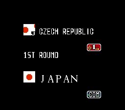
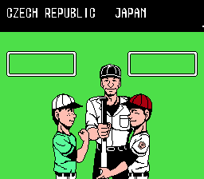
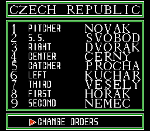
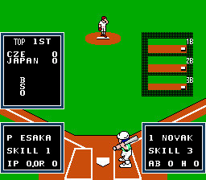

# Real team names on gameplay screens

The team-name stage replaces high-team placeholders and fixes readers
that treated a team ID as a 16-team index. Matchup, pre-game, order,
field HUD, box score and ending readers now use the same metadata as the
selector. Full names come from `data/teams32.json`; constrained field and
box-score labels use the canonical three-letter codes.

The input is password32
`978abc4227eac24d0c779ea3fbbdfdc42c89ca0a1fcce350cff6db44501da34a`.
The frozen candidate is
`5998632da930ec063ea3029320a2b5d901043baa662add8adb8d14b809633f5c`,
with 700 changed bytes. Earlier stage pins stay unchanged. The source pipeline reproduces this hash. Independent review approves the ROM, builder and corrected CPU tests.

## Data and readers

The stock generic text copier uses a descriptor to select its source,
record stride and byte count. The repair assigns its unused descriptors
2 and 3 to high-team code and full-name records. Existing low-team
records and descriptors remain unchanged. The full-name flags retain
stock font choices for teams 0-15 and choose the narrow font for high
names of at least 12 characters. Order headings use centered full names.

| Region | Ownership |
|---|---|
| Bank 1 `$BC80-$BCBF` | Long-name pointers, retaining original low-team pointers |
| Bank 1 `$BCC0-$BDBF` | Sixteen full-name records, 16 bytes each |
| Bank 1 `$BDC0-$BE3F` | Sixteen code records, 8 bytes each |
| Bank 1 `$BE70-$BEAF` | Short-name pointers |
| Bank 1 `$BEB0-$BEFF`, `$BF20-$BFFF` | Short-name storage reservations |
| Fixed `$FD20-$FD3F` | Full-name flags for all 32 teams |
| Bank 4 `$9A00-$9A19` | Bounded HUD and box-score descriptor selection |

The password CONTINUE helper at bank1 `$BE40-$BE6F` and batting-bias
table at `$BF00-$BF1F` remain untouched. The header, CHR and other banks'
assets are unchanged. The builder checks the complete input hash,
expected bytes, reservation bounds and output aliases before writing.

## CPU and tournament evidence

The final CPU suite checks 1,845 reader/team/side/opponent cases,
3,600 exact low-team machine-state comparisons and 2,400 metadata
boundary cases. It rejects malformed inputs and output aliases, checks
owned writes and reads, and fails every high-team oracle on the old ROM.
[CPU evidence](verification/teamnames32-cpu.txt).

The source pipeline and combined stock-six/full-31 SPEED gate pass,
with champion 07, game-over 1 and stack FF at each entry.
[Pipeline](verification/teamnames32-pipeline.txt),
[gate](verification/teamnames32-gate.txt).
The gate's CPU section preceded a test-only correction to the two ending
probe entry addresses. The separate CPU log above reruns the corrected
entries; ROM bytes are identical. SPEED forces CPU ownership on the field.

## Controller evidence

The controller probe first fails on password32 because selecting Czech
Republic produces `FLO` in the field nametable instead of `CZE`. It also
captures the corrupted matchup text, `TEAM 32` cutscene and `T32` order
heading. On the frozen candidate, all 16 high teams reach human play
with their canonical HUD codes, without ownership RAM writes.
[UI log](verification/teamnames32-ui.txt),
[unpatched HUD failure](verification/teamnames32-negative.txt).

Visual inspection confirms the full names on the Czech Republic,
Dominican Republic and South Africa screens. Team 0's complete nametable
is byte-identical to password32 on all four captured screens. The probe
saves screenshots, nametables and OAM; only the HUD has an automatic
five-tile glyph assertion. Other screenshots require visual inspection.

```sh
python3 tools/probe_team_names.py --rom build/teamnames32.nes \
  --team 31 --check-hud --output /tmp/teamnames32-ui
```

A password-restored match also shows both high-team HUD labels, CZE and
NZL, with the human identity preserved through the stock side swaps.
[Resume evidence](verification/teamnames32-resume.txt). Reproduce it with:

```sh
python3 tools/probe_password_ui.py --rom build/teamnames32.nes \
  --seed 0 --played 15 --cpu-mask 0x7FFFFFFF \
  --state-path /tmp/teamnames32-restored.state --session teamnames32-resume
python3 tools/probe_team_names.py --rom build/teamnames32.nes --team 31 \
  --bracket-state /tmp/teamnames32-restored.state --check-hud \
  --output /tmp/teamnames32-resume --session teamnames32-resume
```

Box score and ending readers have CPU coverage only; there is no
controller capture for those screens. The CPU harness aborts execution
outside PRG ROM and rejects the two formerly misaligned probe entries.

Reproduce the high-team sweep by running that command for team IDs 16
through 31. Reproduce the negative control with `build/password32.nes`;
the HUD assertion must fail.

This stage changes text only. Three separate defects remain tracked:
the matchup always says 1ST ROUND, high-team flag reads exceed a 16-entry
table, and high-team uniform colors read screen data beyond the original
palette table. Their bounded repair follows this unit. Hardware and audio
compatibility remain untested.


Captured Czech Republic screens on the candidate:

| Matchup | Pre-game |
|---|---|
|  |  |
| Order | Field |
|  |  |

The [unpatched matchup](verification/teamnames32/before-matchup.png)
shows the previous out-of-table text read.
