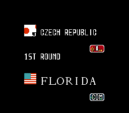
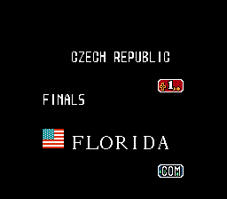

# Matchup rounds, flags and uniform palettes

This stage builds on `teamnames32.nes` (`5998632d`). It fixes three
16-team assumptions without changing the gameplay round counter or
adding flag artwork. The guarded source build produces
`cf4f1126a4afde0cd04bd13f06ebbea2867029cba78cedb3944ee7b15d582780`,
with 133 changed bytes. CPU, controller probes and the final tournament
gate pass. Independent review approves the final ROM, builder and tests.

## Behavior

In an active 32-team series, the matchup uses the bracket's match index
at `$07FC` to select its label. Other modes retain the stock label path.

| Match indices | Matchup label |
|---|---|
| 0-15 | 1ST ROUND |
| 16-23 | 2ND ROUND |
| 24-27 | QUARTER FINALS |
| 28-29 | SEMI FINALS |
| 30 | FINALS |

The mode requires both `$07ED != 0` and `$07EF == $32`. The stage leaves
`$0746` unchanged, including the launcher's existing reset to zero.
That counter also affects gameplay bonuses, so changing it would alter
more than the label.

The shared flag renderer preserves teams 0-15 and omits teams 16-31 in
matchup, stock team-select, power-analysis and ending callers. The separate
bank-10 32-team selector still has its existing placeholder flag area;
this stage adds no artwork there. No CHR data changes.

High team `16+i` uses low team `i`'s existing three-byte uniform palette.
These are explicit stock presets, not a claim about national team colors.
Low-team palettes remain unchanged. The chosen implementation maps the
team ID inside the existing 21-byte pointer routine. A competing design
relocated 96 palette bytes into fixed-bank padding; the in-place mapping
needs no new fixed-bank reservation and preserves low-team final pointer
values. `$05` is temporary scratch during the routine. The builder guards
the stock pointer and all 48 palette bytes before using their constants.

## Byte ownership

| Bank | Changed range | Purpose |
|---|---|---|
| 5 | `$9C42-$9C44` | Dispatch to the guarded round selector |
| 5 | `$BE00-$BE48` | Second-round text and round selector |
| 4 | `$9B00-$9B27` | Hide high-team flag footprints |
| Fixed | `$CB63-$CB65` | Route flag lookup through the guard |
| Fixed | `$C6FE-$C712` | Map high teams to valid palette presets |

The fixed field readers at `$DDA0`, `$DFDD` and `$DFE2` can index CPU
addresses overlapping `$BE00`, but all their reachable callers map bank 6.
Independent review traced direct calls, fallthrough and dispatch paths;
they cannot read the round block in bank 5. NMI restores the recorded bank.

The flag helper honors both entry contracts. `$CB56` draws three rows,
so it clears 36 OAM bytes; `$CB52` draws four rows, so it clears 48.
Clearing the old footprint also prevents stale flags after a redraw.
The first prototype cleared only three rows. CPU checks reject that
prototype for the four-row entry.

Bank 7, CHR, fixed-bank padding, the original palette table and its
pointer, prior-stage reservations and gameplay bonuses are unchanged.

Later, Roster Lab's team-color export can change three operands of this
routine and fill `$F380-$F3DF` in an exported copy so all 32 teams have their
own records. The released Preview 8 is unchanged, and the reservation is
recorded in [the editor contract](editor32.md#team-colors).

## CPU evidence

The final suite executes 2,028 complete matchup cases spanning all 32
teams, both sides and all 31 positions. It checks the text and rendered
two-row tiles, and verifies that `$0746` is never written. Another 1,056
matchup cases compare low-team final machine state in stock and guarded
modes. Stack bytes below the returned stack pointer are not live state.

The flag tests cover 1,312 direct cases, both entry contracts, OAM wrap,
low-to-high redraws and 160 selector/analysis/ending caller cases. Palette
tests cover 1,280 pointer/register/bank cases and 1,152 executions of the
eight live calls. High-team colors equal their assigned stock presets;
low-team final machine state matches exactly. Input negative controls
reproduce all three original bugs. [CPU log](verification/visualtables32-cpu.txt).

The CPU harness does not emulate NMI timing. Root's controller and
integrated tournament runs provide separate runtime evidence.

## Reproduction

The input ROM visibly shows 1ST ROUND after restoring match 30. The
controller probe passes when given that old label and fails when asked
for FINALS. It also detects the incorrect high-team flag sprites.

```sh
.venv/bin/python tools/probe_matchup_round.py \
  --rom build/teamnames32.nes --played 30 --label FINALS
.venv/bin/python tools/probe_matchup_round.py \
  --rom build/teamnames32.nes --played 30 --label '1ST ROUND' --check-flags
```

Both commands must fail on the old ROM. The probe types a password using
controller input, restores a valid heap, launches the matchup and checks
its full 14-column label, including trailing blanks. It renders the expected text through the unchanged
stock font renderer in the CPU harness. It does not use the patched round
selector to derive expected text. Flag checks count sprites inside the
screen's flag rectangles. No gameplay RAM writes are used.

[Old round glyph failure](verification/visualtables32-round-negative.txt),
[old label positive control](verification/visualtables32-round-before.txt),
[old flag failure](verification/visualtables32-flag-negative.txt), and
[old CPU reads](verification/visualtables32-before-cpu.txt) record the
baseline.

The final candidate passes controller checks at positions 0, 15, 16, 24,
28 and 30. Position 15 has two high teams, so both flag rectangles must
be empty. The other cases retain the low-team flag's nine sprites.
A new team-31 series also reaches human gameplay with the CZE HUD label.
[Controller log](verification/visualtables32-ui.txt).

```sh
.venv/bin/python tools/probe_matchup_round.py \
  --rom build/visualtables32.nes --played 30 --label FINALS --check-flags
python3 tools/probe_team_names.py --rom build/visualtables32.nes \
  --team 31 --check-hud
```

The full source pipeline reproduces the candidate.
[Pipeline log](verification/visualtables32-pipeline.txt).
The combined stock-six/full-31 gate passes with exit code 0. All 31
advances record game-over 1 and stack FF; champion is team 03.
[Combined gate](verification/visualtables32-gate.txt). SPEED mode forces
both sides to CPU on field entry; it is separate from the controller-only
probes.
Hardware and audio validation remain blocked on an external setup.

| Before, restored final | Repaired final |
|---|---|
|  |  |

[Quarter-final](verification/visualtables32/quarter-final.png),
[two high teams](verification/visualtables32/high-high.png), and
[human field](verification/visualtables32/human-field.png) captures use
the final candidate.
